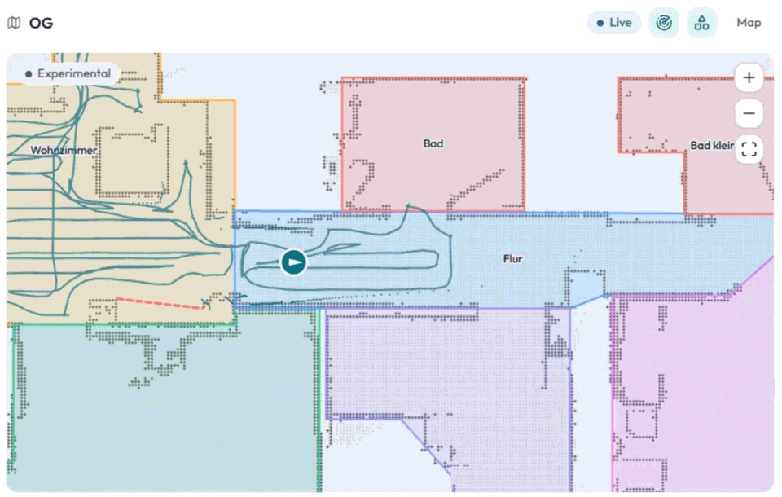
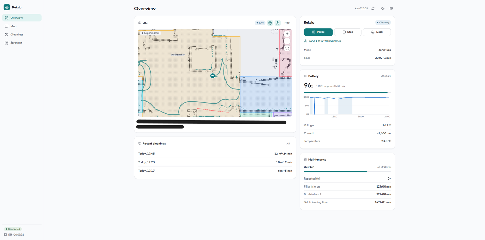
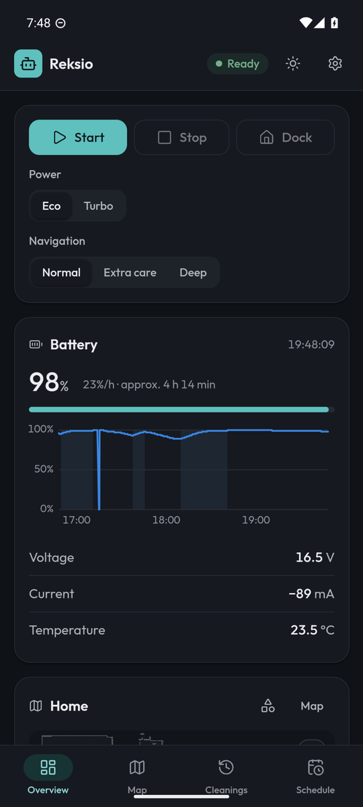
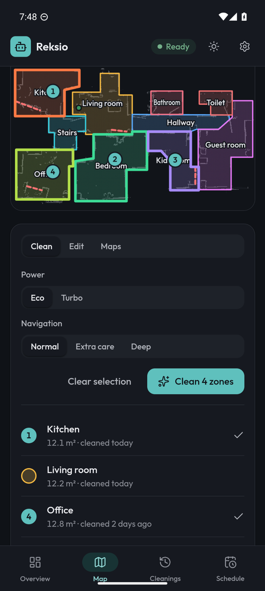
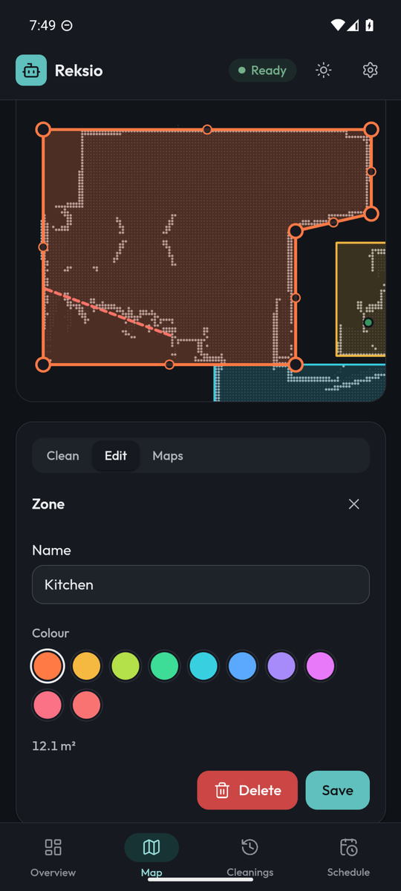
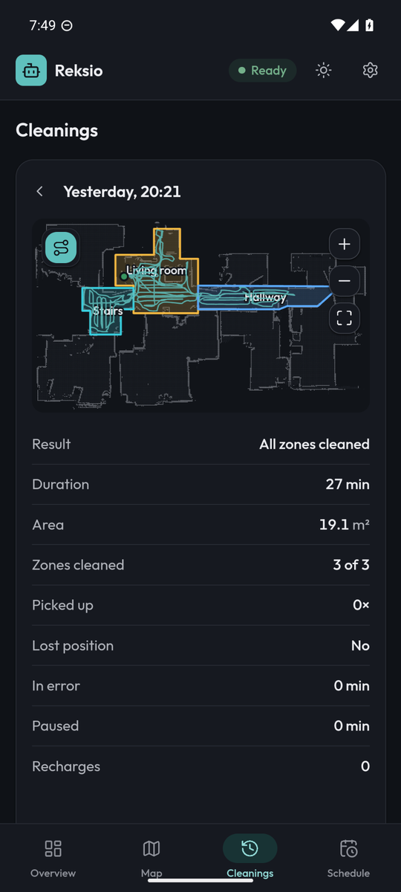
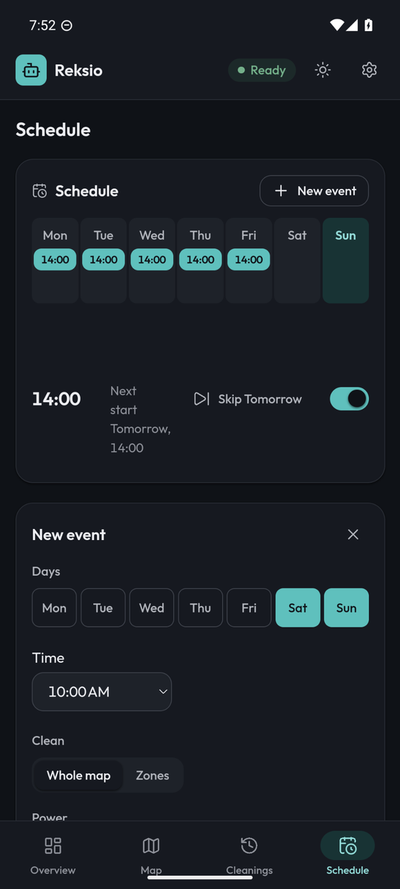
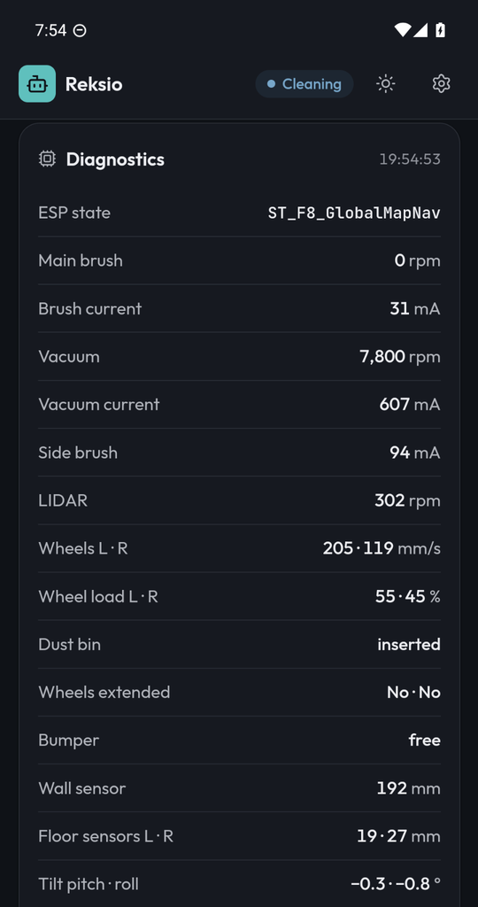

<div align="center">

# Reksio

**Your Neato Botvac, without the Neato cloud.**

A self-hosted server, web app and Android app for Neato robot vacuums: maps, zones, schedules, history and live telemetry, all inside your home network.

[](https://github.com/Volp02/reksio/releases)
[](https://github.com/Volp02/reksio/actions/workflows/ci.yml)
[](LICENSE)

[Features](#features) · [Screenshots](#screenshots) · [What you need](#what-you-need) · [Setup](#setup) · [Changelog](CHANGELOG.md) · [Roadmap](docs/ROADMAP.md)

</div>

<p align="center">
  <br>
  <sub>Live run with position and path (10× speed)</sub>
</p>

---

Neato shut down its cloud, and with it the app. [Vacuula](https://github.com/vacuula/vacuula) brings the robots back by replacing the cloud server. Reksio builds on it with a new web app, a native Android app and an optional ESP32 on the robot's debug port for detailed telemetry.

Tested on the **Botvac D7**. Other robots supported by Vacuula should work as well; the ESP32 telemetry needs a D3 to D7.

## Features

**Cleaning**
- Start, stop and dock with power (Eco, Turbo) and navigation mode (Normal, Extra care, Deep)
- Clean one zone or several zones in a fixed order; zones that fail are retried once
- No-go lines are respected when cleaning the whole map

**Maps and zones**
- Fast, zoomable map; with the ESP32 also the robot's live position and path
- Draw and edit zones and no-go lines; corners snap to the map grid and to neighbouring zones
- Every save is backed up and can be restored; "last cleaned" per zone
- Several maps per robot

**Schedule**
- Runs on the server: whole map or a zone sequence, by weekday and time
- Waits up to 60 minutes for the robot to be ready; skip single dates

**History**
- Every run with area, duration and the driven path on the map
- Schedule and zone runs grouped, result per zone, incidents with timestamps
- Run report: picked up, position lost, time in error or pause, charging stops

**Telemetry** (with the optional ESP32)
- Battery charge, voltage, current and temperature with history and runtime estimate
- Brush and vacuum currents, wall and floor sensors, tilt, turn rate, LIDAR speed
- Live LIDAR scan on the map (experimental)
- Maintenance card: dust bin runtime, filter and brush intervals, total cleaning time

**Android app**
- Same interface as the web app, bundled in the app; only data comes from your server
- Finds the server on your network
- Notifications for errors, finished zones, pauses and skipped schedule dates, also in the background
- Update hint when your server runs a newer version

**Everything else**
- Light and dark theme, English and German
- Optional password for the web app and API
- No cloud, no account, no tracking; data stays on your server

## Screenshots

<p align="center">
  <br>
  <sub>Web app on the desktop: live map with path and LIDAR scan, battery and maintenance</sub>
</p>

<table>
  <tr>
    <td align="center" width="33%"><br><sub>Overview with controls and battery</sub></td>
    <td align="center" width="33%"><br><sub>Clean several zones in order</sub></td>
    <td align="center" width="33%"><br><sub>Draw and edit zones</sub></td>
  </tr>
  <tr>
    <td align="center"><br><sub>History with the driven path</sub></td>
    <td align="center"><br><sub>Schedule with skip</sub></td>
    <td align="center"><br><sub>Live diagnostics from the ESP32</sub></td>
  </tr>
</table>

## What you need

| | What | Notes |
|---|---|---|
| **Robot** | Neato Botvac | D7 tested. See [Vacuula](https://github.com/vacuula/vacuula#readme) for supported models. |
| **Server** | Any always-on machine with Docker | Raspberry Pi 4/5, NAS, mini PC or home server (`amd64` or `arm64`), in the same network as the robot. |
| **Computer + USB cable** | One-time robot setup | To point the robot at your server with the Vacuula installer. |
| **Phone** (optional) | Android 8.0 or newer | The web app works in any browser too. |
| **ESP32** (optional) | Original ESP32 board with 4 MB flash | For telemetry, position and battery diagnostics. D3 to D7 only. |

<details>
<summary><b>ESP32 shopping list</b></summary>

| Part | Notes |
|---|---|
| ESP32 dev board (original ESP32, e.g. ESP32-WROOM-32) | 4 MB flash. The Reksio firmware in the releases is built for the original ESP32. |
| JST XH 2.54 mm 4-pin cable | Plugs into the robot's debug port. |
| T10 security Torx bit, about 150 mm long | To open the robot. |
| Soldering iron | Four wires to the board. |

The ESP32 is powered by the robot's debug port; no extra power supply needed. Photos and a teardown guide are in the [OpenNeato user guide](esp/docs/user-guide.md#hardware-setup).

</details>

## Setup

### 1. Server

Download [`compose.yaml`](https://github.com/Volp02/reksio/releases/latest/download/compose.yaml) from the latest release, set `HOST_IP` to your server's LAN address, then start it:

```bash
docker compose up -d
```

The web app is now at `http://<server>:8050`. The server uses host networking so the robot can find it via mDNS.

| Port | Used by |
|---|---|
| 8050 | Web app, API, Android app |
| 335 | Gen3 robots (D3 to D7) |
| 3443 | Gen4 robots (D8 to D10) |

Update with `docker compose pull && docker compose up -d`.

### 2. Robot

Connect the robot to your computer by USB and run the [Vacuula installer](https://github.com/vacuula/vacuula#configure-the-robot). It points the robot at your server. The robot then shows up in the web app.

### 3. Android app

Download [`reksio.apk`](https://github.com/Volp02/reksio/releases/latest/download/reksio.apk) on your phone and install it (allow installs from your browser when asked). On first start, the app searches your network for the server, or you enter the address by hand.

The web app also offers the download under **Settings → Android app**.

Every APK is built by GitHub Actions and carries a build provenance attestation:

```bash
gh attestation verify reksio.apk -R Volp02/reksio
```

### 4. ESP32 (optional)

1. **Flash** the board once with the [OpenNeato flash tool](https://github.com/renjfk/OpenNeato#quick-start) and set up Wi-Fi in its serial menu.
2. **Install the Reksio firmware** (`reksio-esp32-headless-<version>.bin` from the release) over the air:
   ```bash
   F=reksio-esp32-headless-<version>.bin
   curl -F "file=@$F" "http://<esp-ip>/api/firmware/update?hash=$(md5sum $F | cut -d' ' -f1)"
   ```
3. **Wire** it to the robot's debug port, crossing TX and RX:

   | Robot debug port | ESP32 |
   |---|---|
   | RX | TX (GPIO 17) |
   | 3.3V | 3V3 |
   | TX | RX (GPIO 16) |
   | GND | GND |

4. **Connect** it in the web app under **Settings → Advanced → ESP** (address and UART pins), or set `ESP_HOST` in `compose.yaml`.

The Reksio firmware is headless: it has no web interface of its own and is configured through Reksio.

## How it works

```
                 Wi-Fi (cloud protocol)
 Neato robot ────────────────────────────────►  Reksio server (Docker)  ◄──── Web app / Android app
      │                                              ▲
      └── debug port (UART) ──► ESP32 ── Wi-Fi ──────┘   (optional telemetry)
```

## Repository

| Folder | Contents |
|---|---|
| [`server/`](server) | Server, fork of [Vacuula](https://github.com/vacuula/vacuula) |
| [`web/`](web) | Reksio web app (replaces Vacuula's app) |
| [`android/`](android) | Android app |
| [`esp/`](esp) | ESP32 firmware, fork of [OpenNeato](https://github.com/renjfk/OpenNeato) |
| [`tools/`](tools) | Helper scripts |
| [`docs/`](docs) | Design notes, roadmap |

<details>
<summary><b>Building from source</b></summary>

**Server image** (includes the web app):

```bash
docker build -t reksio .
```

Development server with its own ports and volume: `docker compose -f compose.dev.yaml up --build`.

**Android app** (needs Node 22, JDK 17 and the Android SDK):

```bash
android/build.sh   # -> android/dist/reksio.apk
```

**ESP32 firmware:**

```bash
docker build -t reksio-pio -f esp/Dockerfile.build esp
docker run --rm -v "$PWD/esp:/src" -v reksio-pio-cache:/root/.platformio reksio-pio pio run -e esp32-headless
# -> esp/.pio/build/esp32-headless/firmware.bin
```

Releases are built by [`release.yml`](.github/workflows/release.yml) on every `v*` tag.

</details>

<details>
<summary><b>Upstream</b></summary>

`server/` and `esp/` are `git subtree` imports with their full history.

```bash
git remote add vacuula-upstream https://github.com/vacuula/vacuula.git
git remote add openneato-upstream https://github.com/renjfk/OpenNeato.git

# pull updates
git subtree pull --prefix=server vacuula-upstream main
git subtree pull --prefix=esp openneato-upstream main

# split changes for an upstream pull request
git subtree split --prefix=server -b server-upstream
```

</details>

## Credits

Reksio stands on the work of [Vacuula](https://github.com/vacuula/vacuula) by Philip Magyar and contributors, and [OpenNeato](https://github.com/renjfk/OpenNeato) by Soner Köksal. If Reksio helps you, consider supporting them.

## License

- `server/`: AGPL-3.0 ([`server/LICENSE`](server/LICENSE))
- `esp/`: MIT ([`esp/LICENSE`](esp/LICENSE))
- Everything else: AGPL-3.0 ([`LICENSE`](LICENSE))
